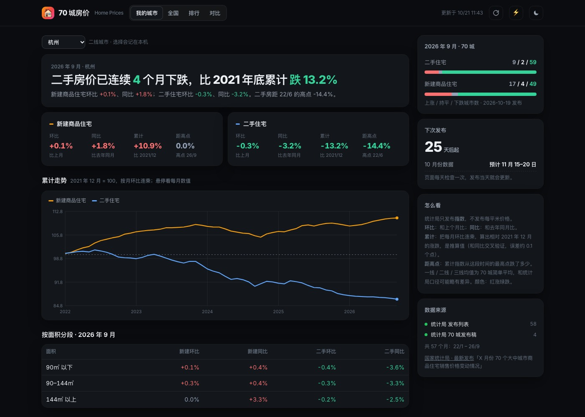
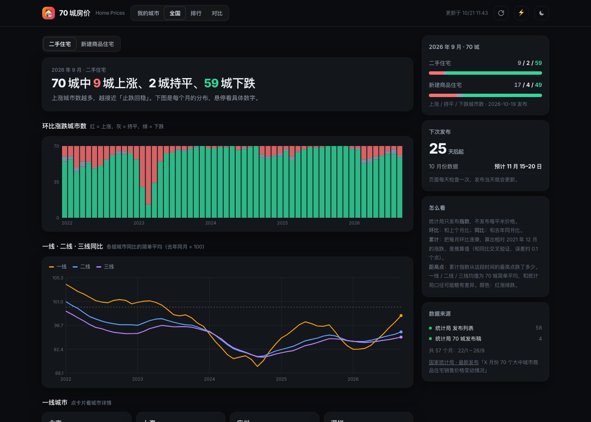

# 🏠 70 城房价 · Home Prices

> 国家统计局每月发布的 70 个大中城市新建商品住宅、二手住宅价格指数：我的城市、全国涨跌分布、城市排行与对比；外加杭州成交活跃小区的成交均价地图

**🌐 在线访问：[https://climb0516.github.io/home-prices/](https://climb0516.github.io/home-prices/)**

---

## 截图

**我的城市**：一句话结论 + 新建 / 二手的环比、同比、比 2021 年底累计、距高点，累计走势和面积分段



**全国**：70 城环比涨跌城市数（每月分布）、一线 / 二线 / 三线同比走势、一线城市卡片



---

## 功能

- **我的城市**（首页，`#city`）
  - 选择城市（按一线 / 二线 / 三线分组，记在本机），默认杭州
  - 一句话结论，例如「二手房价已连续 4 个月下跌，比 2021 年底累计跌 13.2%」
  - 新建、二手各四个数：环比、同比、比 2021/12 累计、距高点（含高点月份）
  - 累计走势：新建 vs 二手两条线，2021 年 12 月 = 100，悬停看每月指数和环比
  - 按面积分段（90㎡ 以下 / 90–144㎡ / 144㎡ 以上）的最新环比、同比
- **全国**（`#nation`）：本月几城涨 / 平 / 跌；每月涨跌城市数堆叠柱（看「止跌」信号）；一线 / 二线 / 三线同比走势；北上广深卡片
- **排行**（`#rank`）：70 城按环比、同比、累计、距高点、连续涨跌月数排序，可切新建 / 二手、按城市等级筛选，涨跌用色块深浅表示
- **对比**（`#compare`）：最多 4 个城市的累计走势叠在一起
- **杭州小区**（`#map`）：高德底图上的杭州成交活跃小区（每月约 500 个）
  - 圆点按成交均价或环比着色，悬停看均价和环比，点开看历月均价走势、同比、同区县均价相近的小区
  - 筛选月份、区县，搜小区名；各区县的小区数、均价中位数、上涨 / 下跌占比；小区列表可按均价、上月、环比排序
  - 全市二手房每月网签套数：概况栏显示当月套数和环比，柱状图看每月走势，点柱子切换地图月份
  - 小区成交套数：只有进了当月「成交排行」（每月套数最多的 10～20 个小区）的才有。列表里成交均价旁显示「28 套 · 第 1」，其余显示「<N」（少于当月最后一名）；地图上上榜小区带橙色粗圈；详情里有当月套数和历次上榜记录；地图下方有当月成交排行表
  - 详情地址可分享：`#/item/xq/<区县>|<小区>`
- 右侧挂件：本月涨跌城市数、下次发布倒计时（统计局通常次月 15–20 日发布）、指标说明、来源状态
- 右上角：↻ 重新读取数据，⚡ 跳转 GitHub Actions 手动触发抓取，☾ 深浅色；手机适配，图表按屏幕宽度重画
- 颜色：红涨绿跌

---

## 技术架构

70 城房价指数（GitHub Actions 自动）：

```
GitHub Actions（触发：每天 10:17 北京时间 / 手动 dispatch / push 修改 scraper.py 或 workflow）
  ↓ python scraper.py（Python 3.12，只用标准库）
  ↓ 翻统计局「最新发布」列表 → 找到每期「X 月份 70 个大中城市商品住宅销售价格变动情况」
  ↓ 缺的月份逐个抓发布稿、解析表 1～6（最新一期总是重抓，防止更正）
  ↓ 计算摘要：本月涨跌城市数、一二三线均值、北上广深
  ↓ 写入 data.json（updated 每次都变 = 心跳）→ git commit → push
       ↓
GitHub Pages（index.html 读取 data.json；累计、高点、排行、图表都在前端计算）
  ↓ 五个视图：我的城市 / 全国 / 排行 / 对比 / 杭州小区
  ↓ kit 详情抽屉（#/item/<类型>/<id>）
```

杭州小区（只能在 macOS 本机手动跑，每月新榜单出来后一次，不在 Actions 里）：

```
python3 xiaoqu.py <杭州网涨跌榜文章网址>     # 登记新的一期；不带参数 = 重新处理已登记的各期
  ↓ 文章所有分页的配图 → .cache/xiaoqu/<文章编号>/（不提交）
  ↓ ocr.swift（macOS Vision，长图切段识别）→ 以「均价」数字为锚点分行，左侧是小区名，标题里取月份和区县
  ↓ 疑似识别错的格子裁出来放大、去浅色水印后重新识别；仍对不上的写进 .cache/xiaoqu/review.txt，人工修正写进 xiaoqu_fix.json
  ↓ 新小区查高德坐标（缓存 xiaoqu_geo.json）→ 合并别名
  ↓ 写入 xiaoqu.json → 手动 git push
       ↓
GitHub Pages（切到「杭州小区」时才加载 Leaflet 和 xiaoqu.json，高德瓦片底图）
```

---

## 数据来源

| 来源 | 方式 | 每次条数 / 范围 | 备注 |
|---|---|---|---|
| [国家统计局 · 最新发布](https://www.stats.gov.cn/sj/zxfb/) 列表 | 网页解析（列表页正则） | 已有完整数据时只看前 3 页；没数据或中间缺月时一直翻到 2022 年 1 月之前 | 取每期发布稿的地址和发布日期 |
| 统计局发布稿表 1 / 表 2 | 网页解析（HTML 表格） | 每期 70 城 × 新建、二手；当前 57 期（2022-01～2026-09） | 环比、同比、年内平均；1 月份没有「年内平均」列，用同比代替（两者相等） |
| 统计局发布稿表 3～6 | 网页解析（HTML 表格） | 70 城 × 3 个面积段；只保留最近 13 个月 | 90㎡ 以下 / 90–144㎡ / 144㎡ 以上 |
| [杭州网](https://hznews.hangzhou.com.cn/jingji/)「杭州二手房价涨跌榜」 | 网页解析 + 图片 OCR（macOS Vision） | 每月一期，每期约 300～600 个小区；目前 8 期（2025-09、2025-12、2026-02、04、05、06、07、09），共 1278 个小区 | 潮新闻美好生活研究院发布，表格注明数据来源中指研究院；只在本机运行 |
| [高德开放平台](https://lbs.amap.com/api/webservice/guide/api/georegeo) | 接口（地理编码 v3/geocode/geo，查不准时用 POI 搜索 v5/place/text） | 只查新小区；POI 搜索每次运行最多 80 次（`SEARCH_BUDGET`） | 高德坐标系，和底图一致；结果缓存在 `xiaoqu_geo.json` |
| 杭州贝壳研究院月度数据（杭州网 / 每日商报 / 潮新闻转载） | 手动摘录新闻原文 | 每月一条：杭州市区（含富阳、临安）二手房网签套数，部分月份有全市成交均价；目前 2025-09～2026-10 共 14 个月 | 存在 `hz_market.json`，每条附出处 |
| 月度小区成交排行（贝壳研究院 / 每日商报 / 我爱我家，见各月 `src`） | 手动转录新闻配图或正文表格 | 每月前 10～20 名小区的成交套数和均价；目前 11 个月有（2025-12、2026-06 没找到，2025-10、2026-10 只有前几名） | 存在 `hz_market.json` 各月的 `top`；`xiaoqu.py` 自动匹配到地图小区；不同月份来源不同，7 月是我爱我家口径 |

**配置位置**
- `scraper.py` 顶部：`BASE`（列表地址）、`START = "2022-01"`（回填起点）、`SIZE_MONTHS = 13`（面积分段保留月数）、`TIER1` / `TIER2`（一线 / 二线城市名单，其余为三线）；列表页匹配标题的正则在 `list_page()`
- `xiaoqu.py` 顶部：`ADCODE`（杭州 13 个区县 → 行政区划代码）、`GEO_LEVELS`（地理编码可接受的返回级别）、`SEARCH_BUDGET`；登记的文章存在 `xiaoqu.json` 的 `articles` 里

**增删来源**
- 70 城：统计局只有这一个来源；要改回填起点改 `START`，要调整城市分级改 `TIER1` / `TIER2`
- 杭州小区：新的一期 = `python3 xiaoqu.py <文章网址>`；删除某期 = 从 `xiaoqu.json` 的 `articles` 里删掉对应条目后不带参数重跑
- 要加别的城市的小区数据，需要新写解析脚本并输出同结构的 json，前端地图目前写死杭州（中心点 `[30.27, 120.17]`）

**限制**
- 统计局只发布**指数**（上月 / 上年同月 = 100），不发布每平米价格；小区均价目前只有杭州
- 统计局网站可能拦截海外服务器；如 Actions 抓取失败，可在本机运行 `python3 scraper.py` 后推送（每月一次即可）
- 杭州小区只含当月「成交活跃」上榜的小区；单个小区均价受当月成交房源结构影响，环比波动较大；表格由图片识别，个别数字可能有误
- 链家 / 贝壳 / 我爱我家的成交价只在 App 里显示，网页翻页每页都要人机验证，所以不用它们的数据

---

## 数据处理规则

**70 城（scraper.py）**
- `fetch()`：带桌面 Chrome UA 和 `Accept-Encoding: gzip`，超时 40 秒，自动解压
- `list_page(n)`：第 0 页 `index.html`，之后 `index_<n>.html`；按标题正则「YYYY年M月份70个大中城市商品住宅销售价格变动情况」取地址，在链接后 800 字内找发布日期
- 翻页规则（`main()`）：数据为空、或从 `START` 到已有最新月份之间有缺月时 `need_backfill`，一直翻到列表里最早月份早于 `START`；否则只翻 0～2 共 3 页；每页间隔 1 秒，翻到 404 就用已找到的
- 待抓月份：列表里有、但 data.json 没有的月份，加上列表里的最新一期（总是重抓）；每期间隔 1.5 秒
- `parse_release(url, tries=3)`：页面里 `<table>` 少于 6 个或「北京」出现不到 2 次视为不完整（疑似限流），重试并依次等 5 / 10 / 15 秒
- 表 1 / 表 2 `main_table()`：每行并排两个城市，每城 4 格（城市、环比、同比、年内平均）；1 月份每城只有 3 格，年内平均用同比补；城市名需是 2～5 个汉字、三个数都能解析；新建或二手少于 60 城则判定失败
- 表 3～6 `size_tables()`：每行 7 或 10 格（1 月份 7 格，每段只有环比、同比，年内平均用同比补），切成 3 个面积段 × [环比, 同比, 年内平均]
- 面积分段只保留最近 13 个月，更早月份删除 `new_size` / `used_size`
- 摘要：`counts` 按环比指数 > 100 / = 100 / < 100 统计涨 / 平 / 跌城市数；`tiers` 为各等级城市 [环比, 同比] 的简单平均（保留 2 位）；`tier1` 为北上广深原始三元组

**前端指标（index.html）**
- 指数转涨跌幅：`idx2pct(v) = v − 100`
- 累计 `chain()`：从 2022-01 起每月环比连乘，2021 年 12 月 = 100；属推算值，用「最近 12 个月环比连乘 vs 同比」交叉验证，70 城平均误差约 0.1 个点、最大 0.4
- 距高点 `cityStats()`：当前累计指数 / 期间最高点（含基期 2021-12 = 100）− 1，并记录高点月份
- 连续涨跌月数：从最新月往前数，环比方向（> 100 或 < 100）相同的连续月数，持平即中断
- 全国视图：每月涨 / 平 / 跌城市数堆叠柱；城市详情里「二手同比 70 城第 N」按二手同比从高到低排名；「走势相近」取同等级城市中二手累计最接近的 6 个
- 下次发布倒计时：按上一期发布日推算次月 15 日起，提示「预计 X 月 15–20 日」

**杭州小区（xiaoqu.py）**
- `article_images()`：从文章地址解析编号和发布日期，读取全部分页（`content_<id>_<n>.htm`），收集正文配图
- `ocr()`：调用 `ocr.swift` 编译出的 `.ocr_bin`（源码比二进制新时自动 `swiftc -O` 重编），结果按图片缓存成 `.tsv`
- `parse_image()`：标题正则取月份和区县（区县必须在 `ADCODE` 里，表格跨图片时沿用上一张的区县）；价格数字（4～6 位、可带千分位）按横坐标最大间隔（> 图宽 8%）分成「本月 / 上月」两列；以价格为锚点按行高中位数 × 0.45 的容差分行，左侧文字拼成小区名（去掉表头词和「潮新闻 NEWS」水印残留）
- 环比一律用两个均价重算：`round((本月 / 上月 − 1) × 100, 1)`；与识别出的 % 相差 > 0.15 时打标记
- `refine_prices()`：缺本月均价、重算环比绝对值 > 25%、或与识别值对不上时，裁出均价格放大（倍数 ≥ 3）并去浅色后重新识别，缓存 `.prices.json`
- `refine_names()`：名字为空或含非中文字符时裁出名字格重新识别，缓存 `.names.json`
- `month_of()`：标题月份大于发布月份时算作上一年
- 过滤：`xiaoqu_fix.json` 的 `drop` 行丢弃，`rename` 改名（可限定某一期）；有标记且不在 `ok` 名单里的行写进 `review.txt`，其中「名称」「缺本月」两类不入库
- `geocode()`：先用「杭州市+区县+小区名」地理编码，返回级别在 `GEO_LEVELS` 且区县一致才采用；否则用 POI 搜索（限定区县、类型 120300 / 120000，每次运行最多 80 次）；额度 / key 错误时停止，下次接着查；`xiaoqu_fix.json` 的 `geo` 手动坐标优先
- `merge_aliases()`：坐标完全相同、一个名字包含另一个、从没在同一期同时出现、名字不含「别墅 / 排屋 / 叠墅 / 洋房 / 公寓 / 括号」、且每期均价与主名字最近一期相差 < 15% → 合并到出现期数最多的名字
- 前端补点 `xqSeries()`：某月没上榜但下个月表里有「上月均价」时用它补；小区同比 = 最近一期均价 / 去年同月均价 − 1

---

## 数据结构

**data.json**（70 城，Actions 生成）

```
{
  "updated": "2026-10-21T11:50:36+08:00",        // 北京时间，每次运行都变（心跳）
  "tiers": { "1": ["北京", "上海", "广州", "深圳"], "2": ["天津", …] },          // 其余为三线
  "months": {
    "2026-09": {
      "url": "https://www.stats.gov.cn/sj/zxfb/202610/t20261019_1965609.html", "published": "2026-10-19",
      "new":  { "北京": [99.8, 97.3, 97.7], … },     // [环比, 同比, 年内平均]，上月 / 上年同月 / 上年同期 = 100
      "used": { "北京": [100.1, 97.5, 93.8], … },
      "new_size":  { "北京": [[…], […], […]] },        // 90㎡以下 / 90~144㎡ / 144㎡以上，各 [环比, 同比, 年内平均]；只有最近 13 个月有
      "used_size": { … }
    }
  },
  "summary": { "month": "2026-09", "published": "2026-10-19",                   // 给 pages-dashboard，字段只增不减
               "counts": { "new": { "up": 17, "flat": 4, "down": 49 }, "used": { … } },
               "tiers": { "new": { "1": [环比均值, 同比均值], "2": […], "3": […] }, "used": { … } },
               "tier1": { "北京": { "new": […], "used": […] } } },
  "sources": [ { "name": "统计局 发布列表", "ok": true, "count": 3, "updated": "…", "error?": "…" },
               { "name": "统计局 70 城发布稿", "ok": true, "count": 1, "updated": "…", "error?": "…" } ]
}
```

**xiaoqu.json**（杭州小区，本机生成）

```
{
  "updated": "…", "city": "杭州", "source": "潮新闻美好生活研究院「杭州二手房价涨跌榜」…",
  "months": { "2026-09": { "url": "…", "published": "2026-10-27", "title": "…", "count": 505 } },
  "items": [ { "n": "滨江金茂府", "d": "滨江区", "loc": [120.2, 30.2],         // loc 为 null = 没查到准确位置
               "p": { "2026-09": [88900, 85837, 3.6] } } ],                 // [当月均价, 上月均价, 环比 %]，元/㎡
  "geo": { "ok": 1272, "miss": 6, "error": null },
  "articles": [ { "id": "9355775", "url": "…", "published": "…", "title": "…", "month": "2026-09", "images": ["…"] } ]
}
```

**hz_market.json**（全市二手房网签套数，手动维护）

```
{
  "city": "杭州", "scope": "杭州市区（含富阳、临安）二手房网签套数", "source": "杭州贝壳研究院（…转载）",
  "months": { "2026-09": { "deals": 6746, "avg": 23200, "url": "摘录出处" },     // avg：全市均价 元/㎡，原文没给为 null
              "2026-02": { "deals": 3370, "avg": null, "url": "…", "tag": "春节",  // tag 显示在柱子上方
                           "top": { "src": "每日商报", "url": "排行出处", "partial": false,  // partial = 只公布了前几名
                                    "rows": [ [1, "星汇城", "临安区", 12, 7685, null],     // [名次, 小区, 区县, 套数, 均价, 匹配到的小区键]
                                              [3, "西溪海", "余杭区", 7, 21309, "余杭区|融创金成西溪海"] ] } } }
}
```

每行第 6 列由 `xiaoqu.py` 的 `match_market_top()` 自动填：同区县内同名 > 互相包含 > 最长公共子串 ≥ 3 且占短名 60%，且候选唯一；同区县没有候选时跨区县找同名或唯一包含（≥ 4 字）。匹配不上的写进 `.cache/xiaoqu/top_miss.txt`，需要手动指定的写进 `xiaoqu_fix.json` 的 `top`：`{ "拱墅区|耀江文鼎苑": "西湖区|文鼎苑", "西湖区|古荡新村": "" }`（空字符串 = 不匹配，用于「古荡新村」「都市阳光」这类统称）。临安、富阳的小区不在涨跌榜里，排行表里标「不在小区地图上」。

**xiaoqu_geo.json**：坐标缓存，键为「区县|小区名」，值为 `{ "loc": [lng, lat], "how": "geo:住宅区" / "poi", "addr": "…" }` 或 `{ "miss": 原因, "retry": true }`（带 retry 的下次重查）。

**xiaoqu_fix.json**（人工修正，可选）：

```
{
  "rename": { "上城区|识别错的名字": "正确名字", "2026-09|西湖区|某名字": "只改这一期" },
  "drop":   [ "拱墅区|不是小区的行" ],
  "ok":     [ "2026-09|萧山区|某小区" ],          // 核对过没问题，不再出现在 review.txt
  "geo":    { "西湖区|某小区": [120.1, 30.2] }     // 手动坐标（高德坐标系）
}
```

**不提交的本地文件**（.gitignore）：
- `.cache/xiaoqu/<文章编号>/`：`00.jpg`、`01.jpg`…（文章配图），同名 `.tsv`（整图 OCR 结果，首行 `W\tH`，之后每行 `y\tx\th\ttext`），`.names.json` / `.prices.json`（补识别结果，键为行的 y 坐标，值为名字字符串 / [本月, 上月] 识别字符串）
- `.cache/xiaoqu/review.txt`：待人工核对的行
- `.ocr_bin`：`ocr.swift` 编译产物
- `.amap_key`：高德 key

**小区相关源码**：`xiaoqu.py`（抓取 + 解析 + 坐标 + 输出）、`ocr.swift`（macOS Vision 识别），流程见下方「Skill 流程」。

---

## 前端

单页 `index.html`，原生 JS，无构建；`fetch('data.json?t=<时间戳>', { cache: 'no-store' })` 读取数据，切到「杭州小区」时再从 cdnjs 加载 Leaflet 1.9.4、`xiaoqu.json` 和 `hz_market.json`。

**kit 详情抽屉**（内联在页面里的通用组件 `KIT`）
- 点击城市、月份柱、小区打开详情抽屉：电脑端从右侧滑出，手机端（≤ 760px）从底部升起；`Esc`、点遮罩或浏览器返回关闭
- 详情地址 `#/item/<类型>/<id>`，写进地址栏，分享链接可直接打开（data.json 读完后 `KIT.boot()`；小区链接会先显示「正在读取小区数据…」，xiaoqu.json 读完后再弹出）
- 链接里的条目在当前数据中找不到（已下榜 / 过期 / 旧链接）时，弹出「这条内容已不在当前数据里」提示，并给「回到首页」按钮

本项目的条目类型：

| 类型 | id | 内容 |
|---|---|---|
| `city` | 城市名，如 `北京` | 新建 / 二手各项指标（环比、同比、累计、距高点、高点月份、连续涨跌）、累计走势图、面积分段、同等级走势相近的 6 城；按钮：设为我的城市、统计局原文 |
| `month` | 月份，如 `2026-09` | 该月新建 / 二手上涨、持平、下跌城市名单，前后月份 |
| `xq` | `<区县>\|<小区名>`（URL 编码） | 小区最近一期均价、环比、同比、历月均价走势、各期表格、同区县均价相近的 6 个；按钮：在地图上看、高德地图、原文 |

本项目没有注册 `#/list/<key>` 列表页；五个视图用单段 hash 切换：`#city`、`#nation`、`#rank`、`#compare`、`#map`。

**项目特有功能**
- 我的城市（默认杭州）、排行的类型 / 排序 / 等级筛选、对比城市（默认北京、上海、杭州、深圳，最多 4 个）、全国视图类型等都记在 `localStorage`，键前缀 `hp70.`
- SVG 折线图按容器宽度重画，鼠标悬停 / 手指按住看每月数值
- 杭州小区地图：高德瓦片底图 + Leaflet 圆点；按成交均价（6 档：1.5 万以下 … 7 万以上）或环比（6 档：跌 5% 以上 … 涨 5% 以上）着色；月份、区县筛选、搜小区名；区县统计表（小区数、均价中位数、上涨 / 下跌占比、最高）；小区列表按均价 / 上月 / 环比 / 名称排序，每次显示 60 个
- 右上角：↻ 重新读取数据，⚡ 跳转 GitHub Actions 手动触发抓取，☾ / ☀ 深浅色（默认跟随系统）；颜色红涨绿跌

---

## Skill 流程（/go-xiaoqu-update）

「杭州小区」地图由 Claude Code skill `/go-xiaoqu-update`（`~/.claude/skills/go-xiaoqu-update/SKILL.md`）每月维护一次，只能在 macOS 本机执行，不在 GitHub Actions 里。用户说「更新杭州小区 / 更新小区房价 / 涨跌榜出了」时触发。

**用到的技术**

| 技术 | 用途 |
|---|---|
| WebSearch（限定 hangzhou.com.cn） | 找杭州网最新一期「杭州二手房价涨跌榜」文章 |
| Python 3 标准库（`xiaoqu.py`） | 下载文章分页和配图、解析识别结果、环比校验、调高德接口、合并别名、写 json |
| Swift + macOS Vision（`ocr.swift` → `.ocr_bin`） | 表格图片文字识别，`VNRecognizeTextRequest`，精确模式，语言 zh-Hans + en-US，关闭语言纠正 |
| 高德 Web 服务 | 地理编码 `v3/geocode/geo`，查不准时 POI 搜索 `v5/place/text` |
| `sips`（macOS 自带） | 人工核对时按行裁出原图 |
| `python3 -m http.server` + Chrome | 本机预览 `http://localhost:8802/?v=<随机数>#map` |
| git + GitHub Pages | 推送上线 |

**数据来源**
- 杭州网「杭州二手房价涨跌榜」：潮新闻美好生活研究院每月一期，表格注明数据来源中指研究院；文章地址形如 `https://hznews.hangzhou.com.cn/jingji/content/YYYY-MM/DD/content_NNNNNNN.htm`（带 `_0`、`_8` 分页后缀也可，脚本会去掉）。每期 8 个分页，每页一张长图，一个区县一张表，列为 小区、本月成交均价、上月成交均价、环比；一般次月下旬刊登（9 月数据在 10 月 27 日刊登）。house.hangzhou.com.cn 上的同名文章是转载，不重复登记
- 高德坐标：高德坐标系，和页面底图一致；key 依次读环境变量 `AMAP_KEY` → 本目录 `.amap_key` → `../hz-weekend/.amap_key`，不打印、不写进会提交的文件

**脚本与文件（输入 → 输出）**

| 脚本 / 文件 | 输入 | 输出 |
|---|---|---|
| `xiaoqu.py <文章网址> ...` | 新文章网址（可多个）；不带参数时用 `xiaoqu.json` 里已登记的 `articles`；`xiaoqu_fix.json`；`xiaoqu_geo.json`；高德 key | `xiaoqu.json`、`xiaoqu_geo.json`、`.cache/xiaoqu/<文章编号>/` 下的图片和识别缓存、`.cache/xiaoqu/review.txt`；终端最后一行「小区 N 个，有坐标 X，未定位 Y；待核对 Z 行」 |
| `ocr.swift`（编译成 `.ocr_bin`） | `ocr <图片>` 整图；或 `ocr <图片> <y0> <y1> <x0> <x1> <倍数>` 只识别一块区域 | 标准输出：第一行 `W\tH`（原图宽高），之后每段文字一行 `y\tx\th\ttext`（中心点坐标、高度，原点左上角，原图像素） |
| `xiaoqu_fix.json` | 人工核对后手写 | 被 `xiaoqu.py` 读取，修正名字、剔除行、标记已核对、手动坐标 |
| `.cache/xiaoqu/review.txt` | `xiaoqu.py` 生成 | 每行 `月份 图片 y=行位置 区县\|小区 本月= 上月= 环比= ⚠原因`，供人工核对 |
| `hz_market.json` | 每月从新闻原文手动摘录（统一用杭州贝壳研究院口径，写入前核对原文） | 被 `index.html` 读取：概况栏「全市二手房网签」、「全市二手房成交量」柱状图、小区成交套数和当月成交排行表；`xiaoqu.py` 运行时会改写它（填匹配列、每条排行一行的格式） |
| `index.html` | `xiaoqu.json`、`hz_market.json`（缺了不影响地图） | 「杭州小区」视图（`#map`）和小区详情抽屉 `#/item/xq/<区县>\|<小区>` |

`.ocr_bin` 不用手动编译：`ocr.swift` 比它新时 `xiaoqu.py` 自动 `swiftc -O` 重编。改了解析逻辑后，删掉对应的 `.tsv`（整图识别）或 `.names.json` / `.prices.json`（补识别）才会重新识别。

**识别算法**
1. 整图识别（`ocr.swift`）：长图整张识别会被缩小导致小字丢失，所以切成 1000 像素高的段、段间重叠 150 像素分别识别，每段只保留中心点落在本段核心区的文字，避免重复
2. 表格解析（`xiaoqu.py` 的 `parse_image()`）：
   - 标题正则 `TITLE` 取月份和区县（区县须在 `ADCODE` 的 13 个区县里；表格跨图片续接时沿用上一张的区县）
   - 价格数字（4～6 位，可带千分位、位于图宽 25% 以右）按横坐标最大间隔（> 图宽 8%）分成本月 / 上月两列
   - 以价格为锚点分行：行高 = 相邻锚点间距（> 20 像素）的中位数，容差 = 行高 × 0.45
   - 价格列左侧图宽 8% 以外的文字拼成小区名，去掉表头词（成交均价 / 环比 / 元/ / 涨跌情况）和「潮新闻 NEWS」水印残留
3. 环比校验：环比一律用两个均价重算 `round((本月 / 上月 − 1) × 100, 1)`；与识别出的 % 相差 > 0.15 打「环比识别≠计算」标记
4. 补识别（`ocr.swift` 区域模式：裁剪 → 放大 → 灰度 → 亮度 ≥ 150 的像素变白，去掉压在字上的浅蓝水印）：
   - `refine_prices()`：缺本月均价、重算环比绝对值 > 25%、或与识别值对不上的行，裁出两个均价格（倍数 ≥ 3）重新识别，缓存 `.prices.json`；仍 > 25% 标「环比过大」
   - `refine_names()`：名字为空或含非中文字符的行，裁出名字格重新识别，缓存 `.names.json`
5. 月份 `month_of()`：标题月份大于刊登月份时算作上一年；一期内取出现最多的标题月份
6. 入库过滤：`drop` 里的行丢弃，`rename` 改名；有标记且不在 `ok` 名单的行写进 `review.txt`，其中「名称」「缺本月」两类不入库

**坐标查询算法（`geocode()`）**
1. 只查新小区（`xiaoqu_geo.json` 没有的，或上次标了 `retry` 的）；`xiaoqu_fix.json` 的 `geo` 手动坐标优先
2. 先地理编码「杭州市 + 区县 + 小区名」（city=330100），返回级别在 `GEO_LEVELS`（住宅区、兴趣点、门牌号、单元号、村庄）且区县一致才采用
3. 否则用 POI 搜索：限定区县 adcode、`city_limit=true`、类型 `120300|120000`、取 1 条，返回区县一致才采用；每次运行最多 80 次（`SEARCH_BUDGET`），超出的标 `retry` 下次再查
4. 每次请求间隔 0.25 秒；遇到 LIMIT / QUOTA / INVALID_USER_KEY / USERKEY_PLAT_NOMATCH 停止，已查的结果每 100 个落盘一次，下次不带参数运行接着查
5. 别名合并 `merge_aliases()`：坐标完全相同、名字互相包含、从没在同一期同时出现、名字不含 别墅 / 排屋 / 叠墅 / 洋房 / 公寓 / 括号、每期均价与主名字最近一期相差 < 15% → 合并到出现期数最多的名字

**xiaoqu_fix.json 结构**

```
{
  "rename": { "区县|错名": "正名", "月份|区县|错名": "只改这一期的正名" },
  "drop":   [ "区县|不是小区的行", "月份|区县|某行" ],      // 汇总行、均价认错的行
  "ok":     [ "月份|区县|小区" ],                          // 核对过没问题（如环比只是丢了负号 / 小数点），不再进 review.txt
  "geo":    { "区县|小区": [lng, lat] }                     // 手动坐标（高德坐标系）
}
```

当前文件里有 13 条 `rename`、0 条 `drop`、10 条 `ok`、0 条 `geo`。均价数字认错时没有按数字修正的字段，只能加进 `drop`。

**步骤**
1. 找新的一期（只读）：列出 `xiaoqu.json` 已登记的月份，WebSearch 搜比最新月份更新的期次（中间漏掉的可一起补）；告诉用户找到的期次和预计耗时（识别约 30 秒一期，新小区查坐标约每 100 个 1 分钟），等用户回复「执行」
2. 跑脚本：`python3 xiaoqu.py <文章网址1> <文章网址2>`；正常每期 8 张图、300～600 个小区。图片不是 8 张或小区数远低于 300 多半是版式变了，需看 `.tsv` 调整 `parse_image()`；「没识别出月份」要改 `TITLE` 正则；「高德额度 / key 问题」第二天不带参数再跑
3. 逐行核对：读 `review.txt`，每行用 `sips --cropToHeightWidth 100 1181 --cropOffset <y-50> 0 <图片> --out <临时目录>/cell.jpg` 裁出原图查看，按情况写进 `xiaoqu_fix.json` 的 `ok` / `rename` / `drop`；再查新增小区名里的错字（同区县、与已有名字只差一个字、从没同期出现、均价相差 15% 以内的大多是错字；朝晖一区～九区、翠苑一区～五区、万科未来城一二三期这类编号小区是真实不同小区）；不带参数重跑直到「待核对 0 行」，并检查输出里的「合并别名」有没有合并错
4. 本机预览：`python3 -m http.server 8802 --bind 127.0.0.1`，Chrome 打开 `http://localhost:8802/?v=<随机数>#map`，确认月份下拉默认是新的一期、小区数和脚本输出一致、地图点没飞到郊外或钱塘江、新小区详情抽屉和走势图正常、控制台没报错；看完 `pkill -f "http.server 8802"`
5. 推送上线（需用户明确同意，如回复「推上线」）：

```
git add xiaoqu.json xiaoqu_geo.json xiaoqu_fix.json
git commit -m "data: 杭州小区 <月份> 涨跌榜"
git pull --rebase      # 远端常有 Actions 机器人更新 data.json 的提交
git push
```

   改了 `xiaoqu.py` 或 `index.html` 也一起提交。推送后每 20 秒用 curl 查一次线上 `xiaoqu.json` 的最新月份，最多 3 分钟（Pages 部署通常不到 1 分钟）
6. 汇总：新增期次和各期小区数、新出现 / 未定位的小区数、改了哪些识别错误、线上地址 https://climb0516.github.io/home-prices/#map、改动文件清单

**注意**
- 不使用链家、贝壳、我爱我家的数据：成交价只在 App 里显示，网页翻页每页都要人机验证，也不尝试绕过

---

## 本地运行

```
python3 scraper.py        # 首次回填约 5 分钟（57 期，每期约 1.5MB，限速下载）
python3 xiaoqu.py         # 杭州小区（macOS；首次识别 8 期约 3 分钟，查坐标约 10 分钟）
python3 -m http.server 8802
# 打开 http://localhost:8802
```

- 依赖：`scraper.py` 只用 Python 3 标准库（CI 用 3.12）；`xiaoqu.py` 另外需要 macOS 和 `swiftc`（Xcode 命令行工具），用来编译 `ocr.swift`
- 环境变量：`scraper.py` 不需要；`xiaoqu.py` 需要高德 Web 服务 key，按顺序读取环境变量 `AMAP_KEY` → 本目录 `.amap_key` → `../hz-weekend/.amap_key`（key 文件已在 .gitignore，不提交）
- 页面必须通过 HTTP 服务打开（直接双击 index.html 时 `fetch` 读不到 json）

---

## 自动更新机制

| 触发方式 | 时机 |
|---|---|
| GitHub Actions 定时任务（cron `17 2 * * *`） | 每天 10:17 北京时间（统计局一般 9:30 发布） |
| push 到 main 分支 | 仅当改动了 `scraper.py` 或 `.github/workflows/scrape.yml` |
| GitHub Actions 手动 dispatch | 按需触发（页面右上角 ⚡ 直达） |
| 本机手动运行 `xiaoqu.py` 并 push | 每月杭州网新榜单发布后一次（不在 Actions 里） |

- workflow：`.github/workflows/scrape.yml`，只更新 `data.json`；`concurrency: scrape`（不取消进行中的任务），权限 `contents: write`
- 运行完执行 `git add data.json`，有变化才提交（提交信息 `data: update <北京时间>`），然后 `git pull --rebase` 再 push
- **心跳**：data.json 里的 `updated` 每次运行都会变，所以每次运行都有提交，仓库保持活跃
- GitHub 规定：仓库 60 天没有提交会自动停用定时任务；有了上面的心跳一般不会触发，若被停用需到 Actions 页面手动重新启用
