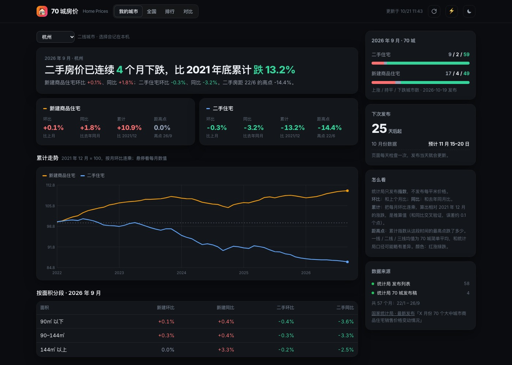
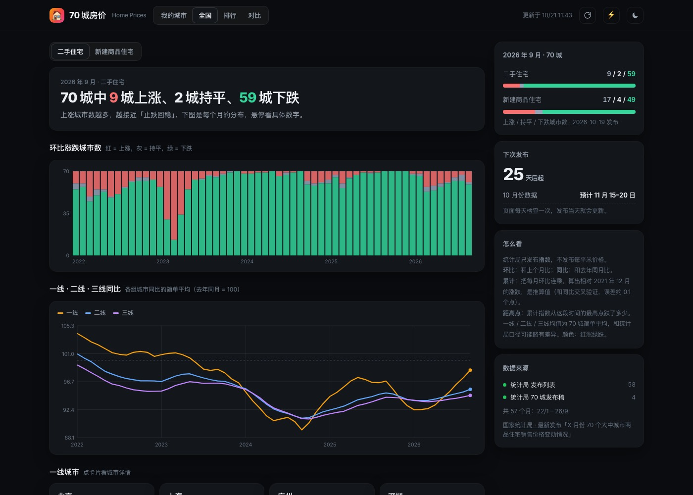

# 🏠 70 城房价 · Home Prices

> 国家统计局每月发布的 70 个大中城市新建商品住宅、二手住宅价格指数：我的城市、全国涨跌分布、城市排行与对比

**🌐 在线访问：[https://climb0516.github.io/home-prices/](https://climb0516.github.io/home-prices/)**

---

## 截图

**我的城市**：一句话结论 + 新建 / 二手的环比、同比、比 2021 年底累计、距高点，累计走势和面积分段



**全国**：70 城环比涨跌城市数（每月分布）、一线 / 二线 / 三线同比走势、一线城市卡片



---

## 功能

- **我的城市**（首页，`#city`）
  - 选择城市（按一线 / 二线 / 三线分组，记在本机），默认杭州
  - 一句话结论，例如「二手房价已连续 4 个月下跌，比 2021 年底累计跌 13.2%」
  - 新建、二手各四个数：环比、同比、比 2021/12 累计、距高点（含高点月份）
  - 累计走势：新建 vs 二手两条线，2021 年 12 月 = 100，悬停看每月指数和环比
  - 按面积分段（90㎡ 以下 / 90–144㎡ / 144㎡ 以上）的最新环比、同比
- **全国**（`#nation`）：本月几城涨 / 平 / 跌；每月涨跌城市数堆叠柱（看「止跌」信号）；一线 / 二线 / 三线同比走势；北上广深卡片
- **排行**（`#rank`）：70 城按环比、同比、累计、距高点、连续涨跌月数排序，可切新建 / 二手、按城市等级筛选，涨跌用色块深浅表示
- **对比**（`#compare`）：最多 4 个城市的累计走势叠在一起
- 右侧挂件：本月涨跌城市数、下次发布倒计时（统计局通常次月 15–20 日发布）、指标说明、来源状态
- 右上角：↻ 重新读取数据，⚡ 跳转 GitHub Actions 手动触发抓取，☾ 深浅色；手机适配，图表按屏幕宽度重画
- 颜色：红涨绿跌

---

## 数据来源

| 来源 | 内容 | 说明 |
|---|---|---|
| [国家统计局 · 最新发布](https://www.stats.gov.cn/sj/zxfb/) 列表 | 每期「X 月份 70 个大中城市商品住宅销售价格变动情况」的地址和发布日期 | 首次运行翻到 2022 年 1 月回填；之后只看前 3 页 |
| 发布稿表 1 / 表 2 | 70 城新建、二手的环比、同比、年内平均 | 1 月份没有「年内平均」列，用同比代替（两者相等） |
| 发布稿表 3～6 | 按面积分段的指数 | 只保留最近 13 个月 |

**指标说明**：
- 统计局只发布**指数**（上月 / 上年同月 = 100），不发布每平米价格
- **累计**：每月环比连乘，相对 2021 年 12 月；属推算值，用「最近 12 个月环比连乘 vs 同比」交叉验证，70 城平均误差约 0.1 个点、最大 0.4
- **距高点**：累计指数相对这段时间最高点（含基期）的跌幅
- **一线 / 二线 / 三线**：统计局分组，均值为简单平均，和统计局正文口径可能略有差异

**限制**：
- 统计局网站可能拦截海外服务器；如 Actions 抓取失败，可在本机运行 `python3 scraper.py` 后推送（每月一次即可）
- 连续下载偶尔拿到不完整页面（疑似限流），爬虫会重试并逐次拉长间隔；缺月份时下次运行自动补
- 只有城市级数据，没有区县、小区和均价

---

## 技术架构

```
GitHub Actions（每天北京时间 10:17 / 手动 / 修改爬虫后 push）
  ↓ python scraper.py（只用标准库）
  ↓ 翻「最新发布」列表找到每期 70 城发布稿 → 缺的月份逐个抓取解析（最新一期总是重抓）
  ↓ 计算摘要：本月涨跌城市数、一二三线均值、北上广深
  ↓ 写入 data.json 并 commit（updated 每次都变 = 心跳，防止定时任务因 60 天不活跃被停用）
       ↓
GitHub Pages（index.html 读取同目录 data.json，累计、高点、排行、图表都在前端计算）
```

### data.json 结构

```
{
  "updated": "2026-10-21T11:45:00+08:00",
  "tiers": { "1": ["北京", "上海", "广州", "深圳"], "2": ["天津", …] },          // 其余为三线
  "months": {
    "2026-09": {
      "url": "https://www.stats.gov.cn/sj/zxfb/202610/t20261019_1965609.html", "published": "2026-10-19",
      "new":  { "北京": [99.8, 97.3, 97.7], … },     // [环比, 同比, 年内平均]，上月 / 上年同月 / 上年同期 = 100
      "used": { "北京": [100.1, 97.5, 93.8], … },
      "new_size":  { "北京": [[…], […], […]] },        // 90㎡以下 / 90~144㎡ / 144㎡以上，各 [环比, 同比, 年内平均]
      "used_size": { … }
    }
  },
  "summary": { "month": "2026-09", "published": "2026-10-19",                   // 给 pages-dashboard，字段只增不减
               "counts": { "new": { "up": 17, "flat": 4, "down": 49 }, "used": { … } },
               "tiers": { "used": { "1": [环比均值, 同比均值], "2": […], "3": […] } },
               "tier1": { "北京": { "new": […], "used": […] } } },
  "sources": [ { "name": "统计局 70 城发布稿", "ok": true, "count": 1, "updated": "…" } ]
}
```

---

## 本地预览

```
python3 scraper.py        # 首次回填约 5 分钟（57 期，每期约 1.5MB，限速下载）
python3 -m http.server 8802
# 打开 http://localhost:8802
```
